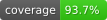
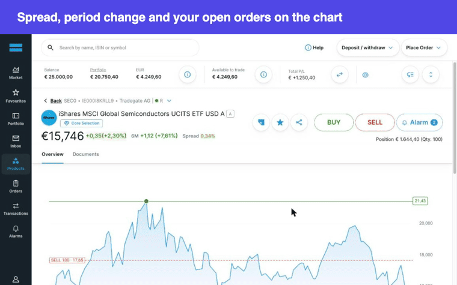

# Tweaks for DEGIRO (unofficial)

A small Chrome extension that adds the features missing from the DEGIRO web trader (trader.degiro.nl). The extra elements are styled to match DEGIRO's own fonts and colours.

> **Unofficial.** Not affiliated with, endorsed or supported by DEGIRO or flatexDEGIRO Bank. DEGIRO is a trademark of its owner.

## Features

**Bid/ask spread**
- Adds a **Spread** row to the *Pricing data* block on every product page, with the absolute and percentage spread (relative to the bid/ask midpoint).
- The row is colour-coded: green < 0.1 %, amber < 0.5 %, red ≥ 0.5 %. It updates live as quotes change. The percentage is rounded to 0.01 %.
- The current spread % is also shown in the product header, after the daily and period change (`Spread 0,07%`).

**Ex-dividend date**
- On share pages, the ex-dividend date from DEGIRO's *Dividends* section is shown after the spread (`Ex-div 12/11/2026`). Click it to jump to Dividends. Hidden when DEGIRO has no date.
- The next earnings date from DEGIRO's *Earnings* section is shown after it (`Earnings 02/02/2027`). Click it to jump to Earnings. Hidden when DEGIRO has no date.

**Compact Pricing data**
- Reduces the spacing between all rows in *Pricing data*: Latest/Bid/Ask…, Volume…, Symbol/Exchange… (12 px → 4 px gap).

**Change for the selected period**
- Next to DEGIRO's daily change in the header, shows the change for the selected chart period, e.g. `1M +0,054 (+2,06%)`. Hidden for 1D.

**Chart range selection (Google Finance style)**
- Click and drag on the price chart to select a period.
- Shows the change in % and in price, the start/end prices and dates.
- Green dots mark the start and end points if the price went up, red dots if it went down.
- A simple click or `Esc` clears the selection. It stays while the price updates live and is cleared when you pick another period.
- The result is also announced to screen readers.

**Portfolio chart**
- Next to the portfolio total: the change over the selected period (1M / 3M / YTD / 1Y), in € and %. It includes deposits and withdrawals.
- Drag on the portfolio chart to see the € and % change between two dates.
- When DEGIRO's eye button hides your amounts, the extension's € amounts and percentages are hidden too; only dates stay readable.
- Amounts the extension shows on the chart (the period change, the drag-selection label and cash) are in whole units, e.g. `€ +49.641`; with *Cash on portfolio chart* on, so is DEGIRO's *Portfolio value* in the hover tooltip. Percentages keep their two decimals.
- **Cash** next to the total: today's cash per currency from your account (e.g. `Cash € 26.876 · $ 1.204`). It is not converted between currencies.
- A *Cash columns on the chart* switch shows the cash per currency as stacked columns over the selected period, EUR at the bottom. The switch is remembered in this browser.

**Open orders on the chart**
- Each open order for the product is drawn as a dashed line at its price, with a badge on the left (e.g. `BUY 200 · 14,10`). Buy orders are green, sell orders red.
- One badge per order: orders at the same or a close price go side by side, each on its own line. If they don't fit in the chart, they merge into one *N orders* badge.
- Orders outside the visible price range are listed in one horizontal row at the top (▲) or bottom (▼) of the chart, with *+N* when not all of them fit.
- **Click a badge** (or Tab to it and press Enter) to open DEGIRO's *Adjust order* form for that order.
- The order list refreshes every 20 seconds, and a few seconds after an order appears in or disappears from DEGIRO's *Outstanding* list.

**Orders page: filters, totals and columns**
- On *Orders → Outstanding*: filter by action (Buy/Sell), currency and product (multi-select). Total buy and total sell value per currency for the shown orders.
- **Columns**: choose which columns to show (every column but Product). *Exchange* is hidden by default; *Reset to default* brings that back. Your choice is remembered and synced.
- The other columns fit their content, so long product names are shown in full.
- **Remembers the sort order**: DEGIRO resets Orders → Outstanding to its default sort (newest first) every time you reload or come back to the page. This extension keeps the column and direction you last sorted by, clicking the same header DEGIRO would. It never overrides a sort you make yourself while the page is open.

**Transactions page: filters, totals and columns**
- On *Transactions*: the same filters by action, currency and product, with total buy, total sell and net (buy − sell) per currency, and the fees in your account currency for the shown transactions.
- Covers the page shown; if DEGIRO has more pages, the count says *this page only*.
- **Columns**: as on Orders. *Exchange*, *Venue*, *Exchange Rate* and *AutoFX Fee* are hidden by default.

**Orders, Transactions and Alarms in the sidebar**
- Orders and Transactions links, and the Alarms item (only while *Price alarms* is on), below *Products* in DEGIRO's left menu, in DEGIRO's own style; the open page's link is highlighted. On a window too short for them, they are left out so DEGIRO's own items stay on screen.

**Price alarms**
- On the page of a product in your *Favourites* (filled star), an **Alarm** button (bell) sits after DEGIRO's *Sell*. It opens a *Set price alarm* panel: the price, the direction (above or below, chosen from the current price; if no current price is shown yet, you pick it with *Rises to* or *Falls to*), how often it repeats (*Once*, *Once a day*, *Every time*), and this product's alarms with an on/off switch and delete. On the Alarms page, **Edit** on a row opens the same panel (*Edit price alarm*) to change the price and repeat; saving keeps the alarm in place, switches it on and lets it fire again.
- When the price reaches an alarm, a banner appears at the top of the page in every open DEGIRO tab, with *Open product* and *Alarms* links and a close button. *Once* alarms switch themselves off. *Once a day* fires at most once per day. *Every time* fires each time the price crosses the level again.
- **Alarms** in the sidebar (below Orders and Transactions, with a count of open banners) opens a page with all your alarms, sorted by product, then price (high to low): filter by status (*All*, *On*, *Off*, *Fired today*) or product, switch or delete them, and see live prices. The "?" next to *Status* explains each status. DEGIRO's own **B**/**S** buttons before each product name open that product's page.
- **Columns**: a *Columns* menu chooses which columns to show (Product and On always show), including *Last* (the price the alarm last checked) and *Seen* (when it was checked); all columns are visible by default.
- **Alarms on the chart**: on a product's page, a gold badge with a bell and the price sits on the chart's right edge at each switched-on alarm; an alarm outside the visible range gets a ▲ or ▼ badge at the top or bottom edge. Click a badge to open the alarm editor for that price.
- In the tabs, prices are read only from what DEGIRO shows on screen (the *Favourites* list and the product page); the extension makes no requests for them.
- **Check in the background** (under *Price alarms*, off by default) checks your alarms every minute while Chrome runs, even with DEGIRO closed or logged out. It uses Yahoo Finance prices, usually 15 minutes delayed, and sends only ticker symbols (e.g. `ASML.AS`) to Yahoo. When a product's ticker doesn't match, its ISIN is looked up once on Yahoo instead, and the result is marked *(via ISIN)*. Chrome asks for notification, Yahoo Finance and Société Générale (sgbeurs.nl) access when you switch it on. Products are matched to their Yahoo Finance ticker by themselves: from the Favourites list on screen, a product's page, or, for the rest, DEGIRO's own product details (symbol, ISIN, exchange), requested once while you're logged in; the Alarms page then shows, in a *Background* column after *Status* (only while the check is on; it can be hidden in *Columns*), each alarm's ticker with ✓ once Yahoo confirms it, *Checking with Yahoo…* while it does, or why it can't be checked: not found on Yahoo, another currency or price, no ticker for that exchange or product type (e.g. futures), or *Not linked yet* until DEGIRO has been open (logged in) since its alarm was set. Alarms whose product has no Yahoo Finance ticker the extension can match aren't checked there. Tradegate products use the Xetra price, which can differ by a few cents and isn't available outside Xetra's hours. Société Générale's own products (turbos, leverage products and certificates on DEGIRO's *Societe Generale OTC* venue), which Yahoo doesn't have, are checked with Société Générale's live bid from its site, sgbeurs.nl, the price DEGIRO shows for them (*✓ SU054L (Société Générale)*); only their ISINs and SG's own product fields are sent there. A reached alarm also shows a system notification; clicking it opens the product in DEGIRO. Chrome grants the permissions per computer: on another computer synced to the same Chrome profile, switch it on there too.
- Up to 25 alarms. **Where are they stored?** In Chrome's own storage, not on a server. The alarm list syncs with your Chrome profile when Chrome sync is on; the last seen prices and open banners stay in this browser. Logging in or out of DEGIRO doesn't change them; removing the extension deletes them.

**Adjust order: click outside or press Esc to close**
- Clicking anywhere outside the *Adjust order* panel, or pressing Esc, closes it, the same as the Cancel or × button, without saving changes. An open DEGIRO confirmation, dropdown or menu takes the Esc first.
- Clicks in DEGIRO's confirmation dialogs and menus are ignored, so the form never closes by accident.

**Portfolio: merged holdings table** (optional, off by default)
- Combines DEGIRO's *Shares*, *Trackers (ETFs)* and *Structured products* tables into one table on the Portfolio page, with a *Type* column naming each holding's section. DEGIRO's three tables are hidden while it is on.
- Click a column header to sort. The table starts sorted by Type, so each section stays together.
- Click a product name to open that product's page. The Buy and Sell buttons before each name work as on DEGIRO's own tables.
- **Columns**: a *Columns* menu chooses which columns to show (Product and Type always show). *Symbol/ISIN* and *Delay* are hidden by default.
- The Product column is capped at DEGIRO's own width, with long names cut off. The **»** button in its header shows full names instead.
- *Previous page* and *Next page* step through the rows.
- **Remember Portfolio table sort & columns** (a sub-setting): keeps your sort, hidden columns and full-name choice across reloads and navigation, and syncs them with your Chrome profile. Off, the table starts again from the default each time.

**Cleaner portfolio**
- Hides the *Cash compensation* section by default, in any DEGIRO language. You can add your own section titles in Settings. A section is hidden only on its own: never the price chart, Pricing data or a box holding other sections.

## Settings

Every feature has an on/off switch. You can open the settings in two ways:
- click the **Tweaks for DEGIRO icon** in the Chrome toolbar (pin it via the puzzle-piece menu), or
- open `chrome://extensions` → Tweaks for DEGIRO → **Details** → **Extension options**.

| Setting | Default |
|---|---|
| Bid/ask spread | On |
| Spread in header | On |
| Ex-dividend date in header | On |
| Earnings date in header | On |
| Compact Pricing data | On |
| Change for selected period (products and portfolio) | On |
| Range selection (products and portfolio) | On |
| Cash on portfolio chart | On |
| Open orders on chart | On |
| ↳ Click badge to adjust | On |
| Click outside or Esc closes Adjust order | On |
| Filters and totals on Orders (+ columns) | On (*Exchange* hidden) |
| Remember Orders sort order | On |
| Filters and totals on Transactions (+ columns) | On (*Exchange*, *Venue*, *Exchange Rate*, *AutoFX Fee* hidden) |
| Merge holdings into one table (Portfolio) | Off |
| ↳ Remember Portfolio table sort & columns | Off |
| Orders, Transactions and Alarms in the sidebar | On |
| Price alarms (button, Alarms page, sidebar item, banner) | On |
| ↳ Alarms on the chart | On |
| ↳ ↳ Click badge to edit | On |
| ↳ Check in the background (Yahoo Finance prices; asks for permissions) | Off |
| Hide sections (+ editable list of titles) | On (*Cash compensation*, in any DEGIRO language) |

The settings open as a short list of collapsed sections. Click a section's title to open it; each section's header shows how many of its switches are on, and the popup remembers on this computer which sections you left open. The switch next to a section's title turns everything in that section on or off, and **All settings** at the top does the same for every switch. They set values, with no memory of the earlier mix. Turning everything on never switches on *Check in the background*, because that asks Chrome for permissions and sends tickers out; turning everything off does switch it off, except on a computer without its permissions, where it stays on for the computers that run it. A section with some switches on and some off shows a half-way switch: a click turns everything on, or, when the only switch left off is *Check in the background*, everything off.

Changes apply instantly to open DEGIRO tabs. Settings sync across your Chrome profiles. The columns are chosen on the Orders, Transactions and Alarms pages themselves, and in the Columns menu of the merged Portfolio table.

Opened from the toolbar over a DEGIRO tab, the popup also shows **On this page**: for each feature, whether it is working, not used on this page, or *Not found* — the last one means DEGIRO probably changed its page, which is useful to mention in a bug report. Its collapsed header sums it up, e.g. *9 Working · 3 Not on this page*. Nothing is stored or sent anywhere.

**Clear saved data**, at the bottom of Settings, erases everything the extension has saved: your settings (back to the defaults), price alarms and their history, the remembered table sort and columns, the background check's ticker links and status, its permissions, and the *Cash columns on the chart* switch (off from the next page load). The first click asks you to click again within 5 seconds. Settings, alarms, ticker links, and table sort and columns sync with your Chrome profile, so they are erased on all your computers; the rest only on this one.

**Feedback or report a problem**, at the bottom of Settings, opens a new issue on the project's GitHub page with the extension version, Chrome version and language filled in. You see and edit everything before submitting it.

## Installation

Install it from the [Chrome Web Store](https://chromewebstore.google.com/detail/gfeegkcebffmddfipcbaoincmnfdjock). Chrome keeps it up to date automatically.

Requires Chrome 111 or newer.

## Privacy & safety

- Runs only on `https://trader.degiro.nl/trader/`, in the main page (not in frames). Its permissions are `storage` (your settings and alarms) and `alarms` (the background check timer), which show no install warning. Three more are optional and requested only when you switch on *Check in the background*: `notifications`, access to `https://query1.finance.yahoo.com`, and access to `https://sgbeurs.nl` (Société Générale's prices of its own products). Chrome removes them when you switch it off. Nothing is sent anywhere else, and there is no analytics or remote code.
- With *Check in the background* on, the only data leaving your browser is the ticker symbols of your alarm products, requested from Yahoo Finance without cookies, and, once per product whose ticker doesn't match, its ISIN. For Société Générale's own products, their ISINs and Société Générale's own product fields go to `sgbeurs.nl`, also without cookies. Yahoo and Société Générale also see your IP address, as with any web request. While logged in, DEGIRO's own product details are also requested from DEGIRO for alarm products not linked yet. Nothing from DEGIRO is sent.
- Portfolio cash is **read** the same way: today's balance per currency from DEGIRO's own cash endpoint, and, only while the *Cash columns on the chart* switch is on, the account statement for the chart's period. Kept in page memory only.
- Open orders are **read** from DEGIRO's own endpoint using your current logged-in session, the same request the DEGIRO web app makes. The session is normally taken from DEGIRO's own requests; only if they don't contain it, the extension asks DEGIRO for it the way the DEGIRO website does, and reads nothing else from that answer but your account number. A session DEGIRO rejects is not used again, and failed requests are retried only after a pause, so the extension never floods DEGIRO with requests.
- The extension never places, changes or cancels orders. Clicking a badge only opens DEGIRO's own edit form; you confirm any change yourself.

## Notes & limitations

- The Transactions totals cover the transactions on the page shown (DEGIRO shows up to 100 per page); the extension makes no extra requests for them.
- Orders are shown only on the chart of the exact listing (exchange/currency) they were placed on.
- If DEGIRO shows a shortened product name that fits more than one order, nothing opens and the badge says so.
- Price alarms are checked only while DEGIRO's *Favourites* or a product page is open in a tab, and only for the *Favourites* list on screen. They don't run when DEGIRO is closed or on other DEGIRO pages, unless *Check in the background* is on.
- At most 25 alarms. An alarm shows an in-page banner in DEGIRO; a background alarm also shows a system notification.
- The Alarms item in the sidebar needs both *Price alarms* and *Orders, Transactions and Alarms in the sidebar* switched on.
- The extension relies on DEGIRO's current page structure, so a DEGIRO redesign may break individual features.
- The extension's own texts are in English, Dutch, German, French, Spanish, Italian and Portuguese. They follow Chrome's language, not the language chosen in DEGIRO; other languages fall back to English.

See [CHANGELOG.md](CHANGELOG.md) for release notes and [PRIVACY.md](PRIVACY.md) for the privacy policy.

## License

[Apache License 2.0](LICENSE) — see also [NOTICE](NOTICE). DEGIRO is a trademark of its owner; this project is not affiliated with DEGIRO or flatexDEGIRO Bank.
